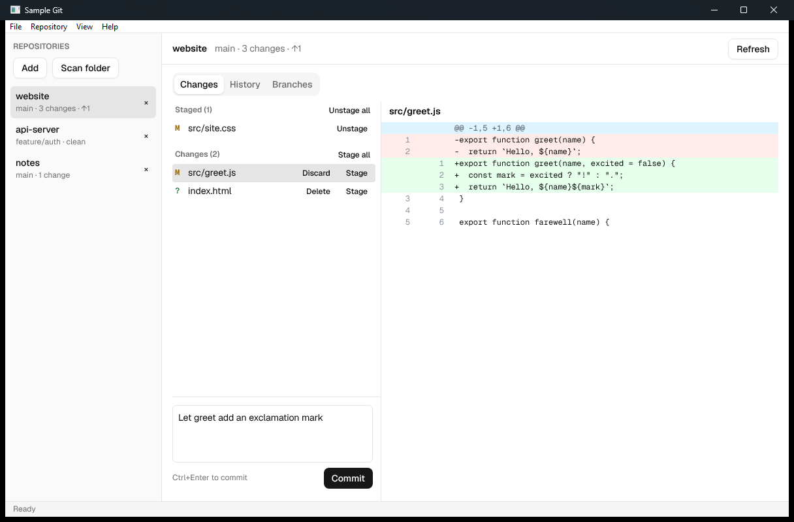
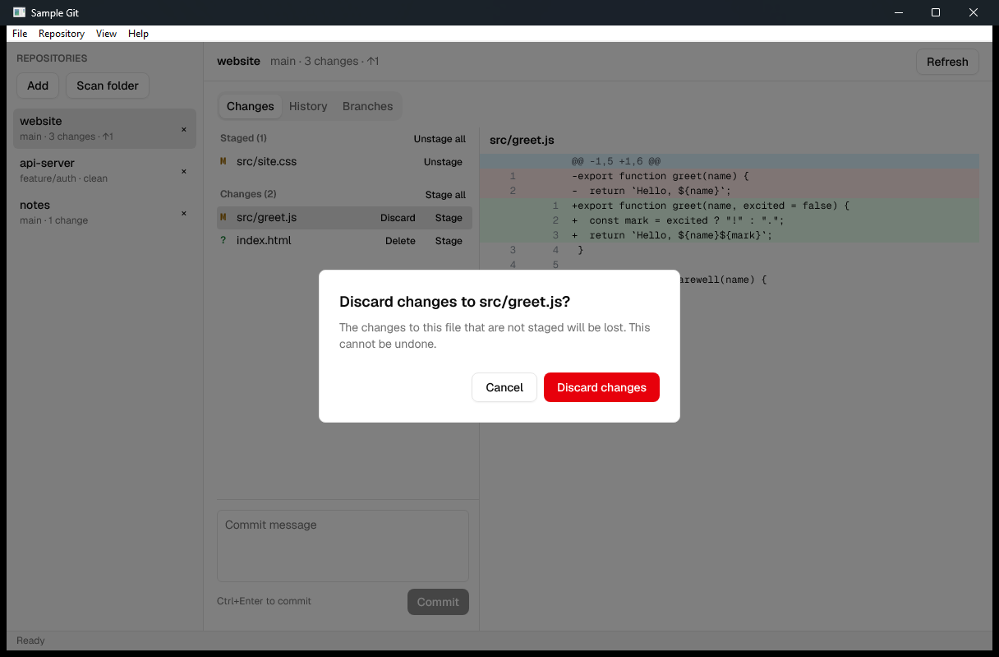
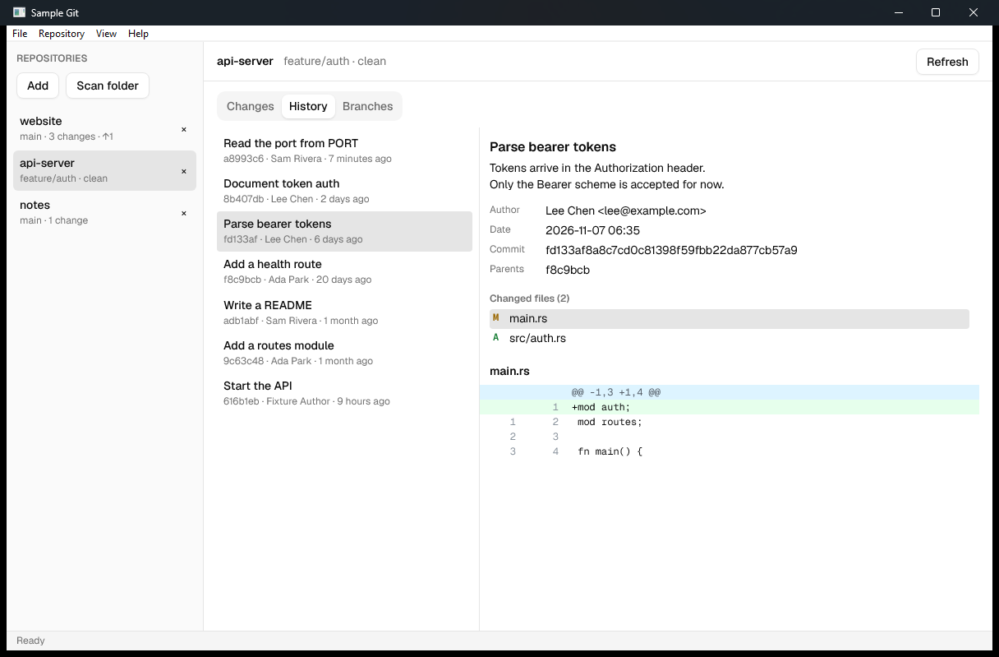
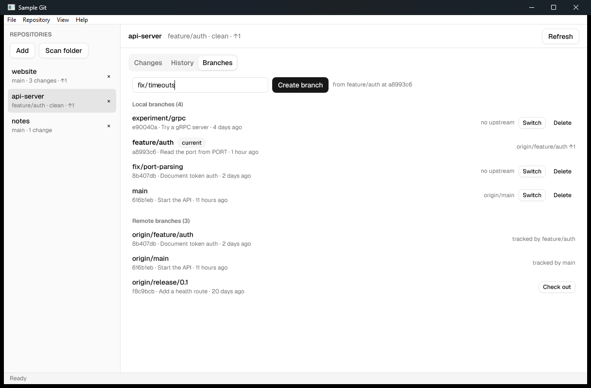

# Sample Git

A small local git client built on [Div](https://github.com/build-with-div/div),
a native Rust UI framework. It is a sample app: it uses only Div's public API,
and part of its job is to find what Div is still missing.

Status: early. You can keep a list of repositories, see each one's status,
stage or unstage files while reading their diffs, discard changes (after a
confirmation), commit, browse history (each commit's message, metadata,
changed files and their diffs), and work with branches: switch, create one
at HEAD, delete a merged one (after a confirmation), and check out a remote
branch as a tracking branch. Fetch, pull and push come next. See
[docs/design.md](docs/design.md) for the plan and
[docs/framework-gaps.md](docs/framework-gaps.md) for the Div gaps found so far.









## Build and run

Div is not on crates.io; `Cargo.toml` pins it to a commit of
build-with-div/div. Div compiles Skia from source, which needs:

- Rust 1.94.1 (`rust-toolchain.toml` selects it), Python 3, Ninja and LLVM
  (clang and libclang).
- Windows: Visual Studio 2022 Build Tools with the C++ workload. Run cargo
  from a shell where `vcvars64.bat` has been applied, with `LIBCLANG_PATH`
  pointing at LLVM's `bin`.
- Linux (Ubuntu 24.04): the packages installed by
  [.github/workflows/ci.yml](.github/workflows/ci.yml), and `CC=clang
  CXX=clang++ CLANGCC=clang CLANGCXX=clang++`.

`.cargo/config.toml` sets Div's Skia build variables. Then:

```sh
cargo run
cargo test
```

The first build compiles Skia and takes a while; later builds are
incremental.
